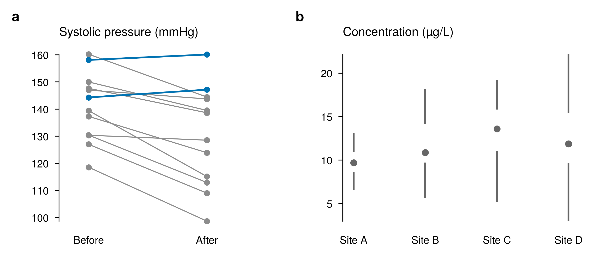
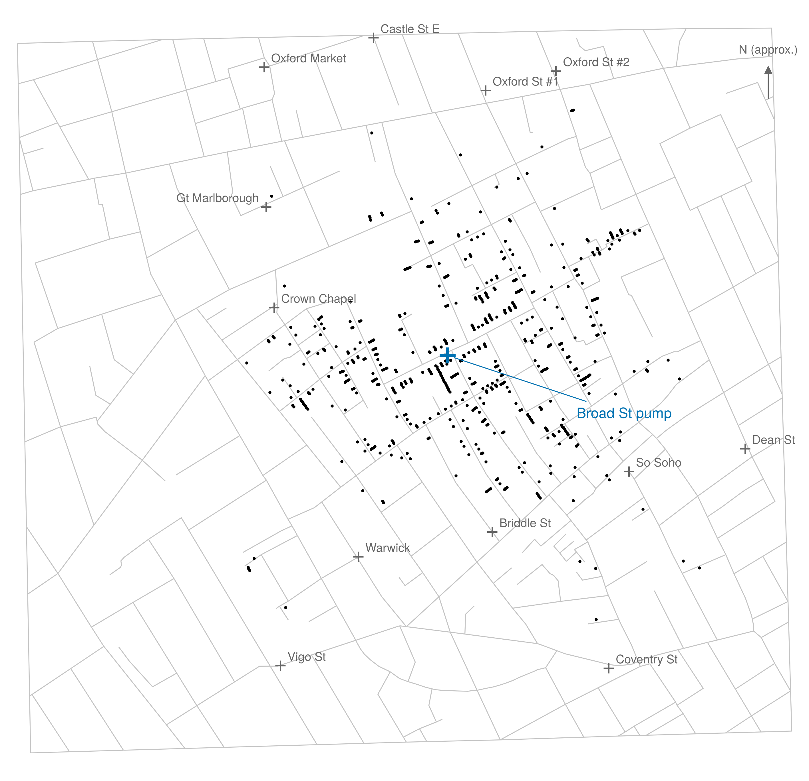

# Tufte

**An agent skill for figures in scientific articles. Edward Tufte's vision governs their style: show the data, make the comparison and the cause visible, carry as much information as the reader can use. Nature's guidance governs their structure: size, panels, what is written on the figure and what in its caption, type and file format. Every rule names its source: Tufte's books, the statistics literature, or Nature's author guidelines.**


**The same data twice: the bar hides that half the Drug A cultures responded and half did not.** **a**, matplotlib's defaults: bars of the means with SEM error bars suggest Drug A and Drug B work equally well. **b**, drawn by this skill. Dots, individual cultures (Drug A in red); horizontal lines, means; vertical lines, 95% confidence intervals of the mean; *n* = 8 independent cultures per group. Four Drug A cultures responded and four did not; the Drug A mean (1.30 a.u.) lies between the two clusters, where no culture lies. Means: control 0.96, Drug B 1.33 a.u. Synthetic data.

```bash
npx skills add mayar-ariss/tufte
```

Works with any coding agent the [skills CLI](https://skills.sh) supports. Covers matplotlib, seaborn, ggplot2 and plotnine, plus maps and schematic diagrams.

## What it does

Ask your agent for a figure as you normally would. The skill applies itself:

- *"Make a single-column Nature figure of the dose–response data in assay.csv, with 95% confidence intervals."*
- *"Redraw this bar chart of group means so reviewers can see the individual measurements."*
- *"Turn these four ggplot panels into one figure with shared axes and panel letters."*
- *"Review this figure script before submission."*
- *"Draw the signalling pathway as a schematic for the paper."*

The skill has three parts. **Tufte governs style; Nature governs structure.** It says **caption** for the text under a figure (Nature's "figure legend") and **key** for the element inside it that explains symbols or colors (what plotting libraries call the legend).

**1. Tufte's principles govern the figure's style** (rules 1–14):

- **Show the data**, not only summaries of it, and keep graphical integrity (the lie factor, bars from zero, the same design across panels).
- **Show the comparison and the cause**: "Compared to what?" answered on the page; the explanatory variable on an axis; every case included, zeros and non-responders too (the lesson of the Challenger O-ring data).
- **Carry information**: small multiples for multivariate data; high data density; multifunctioning elements such as range frames that report the data's range.
- **Label directly**: each series named where it is, in black; no key box. Every question a reader would ask is answered — by a label on the graphic, or in the caption.
- **Stay clear by design, not by omission**: erase what carries no information; layer the rest from dark data to light references, so the figure reads at a glance and up close.
- **Tufte's colors: black and grays, one red accent, muted fields**; color last, strong color only in small areas, Okabe–Ito only when several categories must be colored; type that is clear, precise and modest, running horizontally.

**2. The statistics literature adds the evidence Tufte left open** (rules 15–19): every observation for small samples instead of dynamite plots, error bars defined as SD, SEM or 95% confidence intervals, *n* stated, effect sizes before p-values, log axes for multiplicative data.

**3. Nature's guidance governs the structure** (rules 20–25), superseding Tufte and other journals wherever they differ: 89 or 183 mm wide and at most 170 mm tall; Helvetica or Arial at 5–7 pt, black text; labels only on the figure, with values, notes, *n* and symbol definitions in the caption; a caption that opens with a brief title and stays under 300 words; 8 pt bold panel letters; line weights from 0.25 to 1 pt; vector AI, EPS or PDF with embedded fonts.

Nothing is invented: no target line, comparison or explanatory variable that is not in the data.

If your project already has a figure style, the skill keeps its look and applies Tufte's principles, the evidence rules and Nature's structure to the content.

## Faithfulness to Tufte

Tufte wrote about printed evidence, and many of his central examples are scientific: Snow's cholera map, Minard's map of the Russian campaign, the Challenger O-ring data. His vision suits a journal page, and the skill keeps it whole. Tufte is often read as a minimalist; he is not. He asks for the data, the comparison and the cause, as much detail as the reader can use, and words with the data — and he erases only what carries no information. "To clarify, add detail" (*Envisioning Information*, ch. 2).

Where the skill departs from him, it says so in the rule and lists the departure here:

| Departure | Why |
|---|---|
| **Explanations, values and symbol keys in the caption** | Tufte writes explanations on the graphic itself. Nature asks for text, including keys to symbols, in the caption where possible. The skill keeps only labels on the graphic and moves the rest to the caption, so nothing is lost. |
| **Labels in black** | Nature recolours colored text; a label's position, not its color, ties it to its series. |
| **The title in the caption** | Tufte puts a detailed title on the graphic; Nature's captions begin with it. |
| **Helvetica instead of serif type** | Tufte sets data graphics in serif type (*The Visual Display of Quantitative Information*, p. 183). Nature asks for Helvetica or Arial. Only the typeface changes: everything else he asks of type holds, and his own books set tables in a sans serif. |
| **Bold panel letters; lower case with an initial capital** | Nature's style. The case rule is a narrower form of Tufte's upper-and-lower case. |
| **Error bars, p-values, log scales** | Tufte gives no rule; the skill takes them from the literature: Cumming et al. (2007), Vaux (2012) and Krzywinski and Altman (2013) on error bars, Weissgerber et al. (2015) on showing the data, Wasserstein and Lazar (2016) on p-values, Cleveland (1994) on log scales, Wong (2011) and Crameri et al. (2020) on color. These extend Tufte; none contradicts him. |

Each rule is labeled **Tufte** (book and chapter), **Literature** (author and year), **Journal** (Nature, quoted, with the date read), **convention** or **extension**.

## Examples

All figures are drawn at Nature's widths by `_docs/generate_showcase.py`, which runs the same code the skill gives an agent. Each carries labels only; its caption, in Nature's form, carries the values. Data are synthetic except for the cholera map.


**Drug B raises the response and lowers the half-maximal dose about 9-fold.** **a**, Response of each culture (dots); horizontal lines, means; vertical lines, 95% confidence intervals of the mean; *n* = 8 independent cultures per group. Means: control 0.99, Drug A 1.11, Drug B 1.41 a.u. **b**, Response against dose (log scale); points, means of *n* = 4 cultures per dose; bands, 95% confidence intervals; open circles, half-maximal doses (EC50), interpolated between doses: control 2.65 µM, Drug B 0.30 µM (8.7-fold). Synthetic data.

*Nature single column, 89 mm; range frames whose ends report the data's range; 8 pt bold panel letters. From `examples/matplotlib-publication.py`, which checks this caption against the data.*


**Mice on the high-fat diet gained the most mass; those on the restricted diet lost mass.** Body mass over 12 weeks on four diets, one scale in every panel. Thin gray lines, individual mice; heavy lines, diet means (high fat in red); gray band, week-0 range of all 32 mice; *n* = 8 mice per diet. Week-12 means: standard 26.3 g, high fat 31.7 g, high sugar 29.2 g, restricted 24.0 g. Synthetic data.

*Small multiples with two readings, 183 mm: at a glance, the four means; up close, every mouse. The gray band is Tufte's device for a normal range.*



**Pressure fell in most subjects; concentrations differ by site.** **a**, Systolic pressure before and after treatment; one line per subject (*n* = 12); pressure fell in 10 subjects and rose in 2 (red). **b**, Concentration at four sites, ordered by median; dots, medians; lines, the lowest and highest quarters of the data, with a gap for the middle half (minimum, quartiles, median, maximum); *n* = 40 samples per site. Medians: site A 9.7, site B 10.9, site D 11.9, site C 13.6 µg/L. Synthetic data.

*Tufte's designs for distributions, 120 mm: a slopegraph and his quartile plot, which drops the box.*



**Cholera deaths in Soho, 1854, cluster around the Broad Street pump.** Dots, deaths (one per death, 578 in all); crosses, water pumps (Broad Street in red). Deaths nearest each pump by straight-line distance: Broad St 359, So Soho 64, Crown Chapel 61, Briddle St 27, Oxford St #2 24, Warwick 16, Oxford St #1 12, Gt Marlborough 6, Vigo St 4, Dean St 2, Coventry St 2, Castle St E 1, Oxford Market 0. The population at risk is not shown (Tufte, *Visual Explanations*, p. 35). Data: Snow (1855), digitized by Dodson and Tobler, via the R package HistData.

*Drawn by `rules/maps.md`, 120 mm. Every pump's count is in the caption, zeros included, so the comparison is complete.*

### The palette

A palette belongs in a table, not a chart (Tufte, *The Visual Display of Quantitative Information*, ch. 9). Contrast against a white page; the skill asks 3:1 for marks and 4.5:1 for text.

| Color | Hex | Contrast | Use |
|---|---|---:|---|
| Black | `#000000` | 21 | Data, text, axes |
| Gray | `#666666` | 5.7 | Context |
| Light gray | `#8c8c8c` | 3.4 | Individual observations, references |
| Accent red | `#CC0000` | 5.9 | The finding; its value in the caption, its label in black |
| Second accent blue | `#0072B2` | 5.2 | A second kind of highlight, only when needed |
| Field gray | `#e5e5e5` | — | Normal ranges, bands, large areas |
| Field blue | `#dce9f5` | — | Water, a second large area |

Black, grays, a red accent with blue as its pair, and muted fields are Tufte's own practice (*Envisioning Information*, ch. 5; *Beautiful Evidence*, pp. 46–63); the hex values are the skill's, checked for contrast and in simulations of color-vision deficiency. When three or more categories must be colored, the Okabe–Ito palette is the fallback.

`scripts/check_contrast.py` checks the palette documented in `rules/typography-and-color.md`, so it cannot drift.

## Supported libraries

| Library | Rule file | Language |
|---|---|---|
| [matplotlib](https://matplotlib.org/) and [seaborn](https://seaborn.pydata.org/) | `rules/matplotlib.md` | Python |
| [ggplot2](https://ggplot2.tidyverse.org/) | `rules/ggplot2-plotnine.md` | R |
| [plotnine](https://plotnine.org/) | `rules/ggplot2-plotnine.md` | Python |

## How it's organized

| Path | What it holds |
|---|---|
| `SKILL.md` | The workflow and 25 rules in three parts — Tufte's principles (style), scientific evidence, Nature's structure — with chart types, quick references, anti-patterns, a checklist and the list of departures from Tufte. The agent always reads this. |
| `rules/matplotlib.md` | Setup, layers, helpers (range frames with labeled ends, black direct labels, Nature panel letters, confidence intervals, quartile and paired plots, log axes), complete examples with Nature-style captions, export |
| `rules/ggplot2-plotnine.md` | A journal theme, the same figures in ggplot2 and plotnine, patchwork panels, export with embedded fonts |
| `rules/typography-and-color.md` | Helvetica or Arial at Nature's sizes, Tufte's palette (Okabe–Ito as the fallback), color maps, contrast on white |
| `rules/small-multiples-and-panels.md` | Multi-panel layout, small multiples, slopegraphs, quartile and dot-dash plots, sparklines in tables |
| `rules/anti-patterns.md` | Common faults in scientific figures, with per-library detection and fixes |
| `rules/journals.md` | Nature's requirements for figures and captions, quoted and dated; other journals for reference |
| `rules/references.md` | Full references for Tufte, the literature and the journal guides |
| `rules/maps.md` | Maps, drawn only from Tufte's writing on data maps |
| `rules/diagrams-flowcharts.md` | Schematics and mechanism diagrams, drawn only from Tufte's writing on connectors, layering and explanation |
| `examples/matplotlib-publication.py` | A complete two-panel Nature figure that prints and checks its own caption |
| `scripts/check_contrast.py` | Checks the documented palette against the contrast minimums |
| `scripts/check_code.py` | Runs every Python code block in `rules/matplotlib.md` and the example |
| `_docs/` | The README figures and the script that draws them |

## Contributing

Issues and pull requests are welcome. Before opening a PR:

- **Changed a color?** Update `rules/typography-and-color.md`, then run `python3 scripts/check_contrast.py`.
- **Changed Python code in `rules/matplotlib.md` or `examples/`?** Run `python3 scripts/check_code.py`; it exits non-zero if any block fails.
- **Changed the README figures?** Run `python3 _docs/generate_showcase.py`. It checks each caption's claims against the data; update the README caption if the data change.
- **Changed a Nature requirement?** Quote Nature's current guide in `rules/journals.md` and update the date.

The figures in `_docs/` were rendered with TeX Gyre Heros, a free metric clone of Helvetica; on a machine with Helvetica installed, the scripts use Helvetica.

## Credits

This skill began as a fork of [caylent/tufte-data-viz](https://github.com/caylent/tufte-data-viz) by Caylent, a general Tufte skill for charts and dashboards, and all credit for the original goes to its authors. It has since been rewritten for scientific articles: Nature's structure for figures and captions, the statistics of uncertainty, print typography and color, rules for data maps and analytical diagrams, and a source label on every rule.

## Based on

- Edward Tufte, *The Visual Display of Quantitative Information* (1983; 2nd ed. 2001), *Envisioning Information* (1990), *Visual Explanations* (1997), *Beautiful Evidence* (2006)
- Nature's author guidelines: formatting guide, final submission and research figure guide
- The statistics and visualization literature listed in [`rules/references.md`](rules/references.md)

## License

MIT; see [LICENSE](LICENSE). Original work © 2026 Caylent; additions and changes in this repository © 2026 Mayar Ariss, under the same license.
