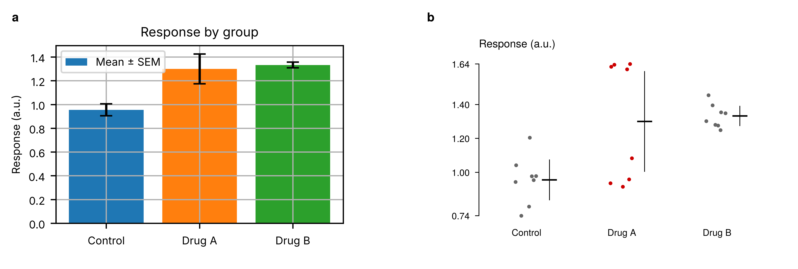
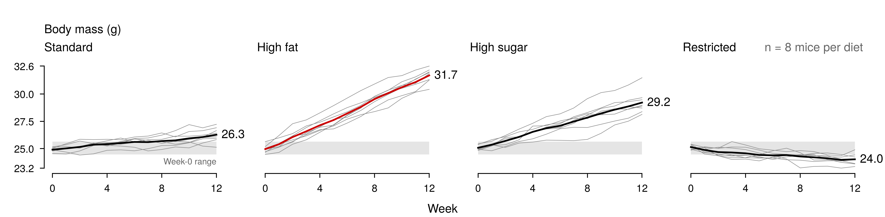

# tufte-skill

**Your agent's charts, maps and diagrams, drawn by Edward Tufte's rules. Every rule names its source in his books, and says so plainly when a rule is not his.**



```bash
npx skills add mayar-ariss/tufte-skill
```

Works with Claude Code, Cursor, Codex, GitHub Copilot, Gemini CLI and any agent the [skills CLI](https://skills.sh) supports. Covers matplotlib, seaborn, Plotly, ggplot2, plotnine, Vega-Lite, Altair, Observable Plot, Recharts, ECharts, Chart.js and D3/SVG, plus maps and flowcharts, with accessibility, dark mode and responsive layout built in, and a separate profile for figures in [scientific articles](#scientific-articles).

**[Live demo](https://mayar-ariss.github.io/tufte-skill/)**: toggle default and Tufte styling in ECharts, Chart.js, Plotly and D3, light and dark · [Examples](#examples) · [Scientific articles](#scientific-articles) · [What it does](#what-it-does)

## Try it

Once installed, ask your agent for a chart the way you normally would. The skill applies itself:

- *"Plot monthly revenue against target from sales.csv with matplotlib."*
- *"Build a Recharts bar chart of signups by channel, sorted."*
- *"Review this ECharts config and remove the chartjunk."*
- *"Make a dark-mode version of this Plotly dashboard."*
- *"Draw a flowchart of our order process in Mermaid."*
- *"Make a single-column Nature figure of the dose–response data in assay.csv, with 95% confidence intervals."*

## Fair warning

This skill is **opinionated by design**. It will remove your gridlines, replace your legends with direct labels, reject your pie charts, and default to serif type (Helvetica for journal figures; see below). It enforces a specific visual philosophy — Tufte's — not a neutral one. If you want total creative freedom over your chart styling, this is not the skill for you. If you want every chart to come out clean, honest, and readable without thinking about it, read on.

## Examples

Gridlines fade, legends become direct labels, chartjunk dissolves:


<table>
  <tr>
    <td width="50%"><br><b>Line chart</b> — direct labels, range-frame axes, annotation</td>
    <td width="50%"><br><b>Bar chart</b> — sorted by value, leader highlighted</td>
  </tr>
  <tr>
    <td><br><b>Slopegraph</b> — before/after comparison</td>
    <td><br><b>Small multiples</b> — shared scale, minimal chrome</td>
  </tr>
  <tr>
    <td><br><b>Sparklines</b> — with beginning and ending values, Tufte's red first/last and blue low/high marks</td>
    <td><br><b>Data table</b> — whitespace, thin rules, outlier highlighted</td>
  </tr>
  <tr>
    <td><br><b>Dark mode</b> — designed palette, not inverted</td>
    <td><br><b>Accessible scatter</b> — shape + color, readable without color</td>
  </tr>
</table>

<br>
<b>Light & dark</b> — the same chart in both themes

<br>
<b>Data map</b> — John Snow's 1854 cholera data drawn by `rules/maps.md`: one dot per death, a quiet base map, the only strong color on the Broad Street pump, and the source and limits on the map

### Accessible palette

Every text and data color meets the skill's own contrast rule: 4.5:1 for text, 3:1 for data marks. `scripts/check_contrast.py` checks the documented palette so it can't drift.


## Scientific articles

Tufte wrote about printed graphics, and many of his central examples are scientific: Snow's cholera map, Minard's map of the Russian campaign, the Challenger O-ring data. His principles suit a journal page well. This skill's defaults do not, because they are written for screens: an off-white background, serif type, a headline title in the chart, pixel sizes, tooltips and dark mode.

So figures for journal articles, preprints and theses get their own profile, [`rules/scientific-articles.md`](rules/scientific-articles.md). It keeps Tufte's principles and changes the house style around them, and it says which is which:

| Kept from Tufte | Changed for the journal page |
|---|---|
| Graphical integrity, data-ink, no chartjunk | White page instead of off-white |
| Direct labels, range-frame axes, gray first | **Helvetica** instead of serif type, at the journal's sizes (5–7 pt for Nature) |
| Small multiples on a shared scale | Widths in millimeters (89 or 183 mm for Nature) instead of pixels |
| Quartile plots, dot-dash plots, slopegraphs | The finding and the documentation in the caption, not a title on the plot |
| Upper-and-lower case, words spelled out | Error bars and intervals shown and defined; individual observations for small samples |
| "Compared to what?" | Okabe–Ito colors, perceptually uniform color maps, vector PDF with embedded fonts |

Helvetica is the one place the profile departs from Tufte's own preference: he sets data graphics in serif type, while Science prefers Helvetica and Nature asks for Helvetica or Arial. The file explains the choice, and notes that Tufte himself sets tables in a sans serif. Where Tufte gives no rule (error bars, significance marks, log scales), the profile cites the statistics and visualization literature instead: Cumming et al. (2007) and Krzywinski and Altman (2013) on error bars, Weissgerber et al. (2015) on showing the data, Wong (2011) and Crameri et al. (2020) on color, and Rougier et al. (2014) on figures. Journal requirements are quoted from the Nature, Science and PLOS author guidelines, with the date they were read.

<br>
<b>Journal figure</b> — Nature single column (89 mm), drawn by `examples/matplotlib-publication.py`: every observation shown, means with 95% confidence intervals, a log dose axis, direct labels, bold lowercase panel letters, no title in the artwork, vector PDF with embedded fonts. Synthetic data; the script checks its caption against the data.

## What it does

Every rule names its source: **Tufte** (cited by book and chapter), **convention** (common Tufte-style practice he did not state), or **extension** (added by this skill's authors). Tufte's principles are never mixed with the skill's own choices.

**Graphical integrity** — Tufte's six principles from *The Visual Display of Quantitative Information*, checked before anything else:

- Proportional representation (the lie factor), clear labeling, data variation rather than design variation
- Deflated units for money over time, no more dimensions than the data has, no data out of context

**Data-ink** — Tufte's five data-ink principles ("within reason"), his three forms of chartjunk (moiré vibration, dark grids, the duck), and what he asks for beyond erasing: data density, multifunctioning elements, micro/macro readings.

**Analytical design** — the six principles of *Beautiful Evidence* ch. 5, including documentation: every chart states its source and units.

Then 22 universal rules in three tiers, plus guidance on chart types and diagrams:

<details>
<summary>Show the rules</summary>

**Static principles (rules 1–14)** — mostly Tufte's data-ink principles, with a few conventions labeled as such:

- Maximize data-ink ratio — remove gridlines, borders, legends, and decoration that don't convey data
- Direct labeling, range-frame axes, no 3D, no pie charts (unless forced), no dual y-axes
- Serif type in upper-and-lower case with words spelled out (Tufte's friendly data graphic), gray as primary color with selective highlighting, off-white backgrounds (a convention)
- Annotate notable features, show comparison context, minimal tooltips

**Screen-first principles (rules 15–19)** — extensions for modern interactive contexts. Where one pulls against Tufte (progressive disclosure vs. his data density), the rule says so:

- Progressive disclosure (overview first, details on hover/tap/click)
- WCAG accessibility (contrast ratios, dual encoding, keyboard nav, screen reader text alternatives)
- Responsive design (fluid/adaptive strategies, touch targets, mobile-adapted chart types)
- Purposeful animation (data transitions only, respect `prefers-reduced-motion`)
- Intentional dark mode (semantic color tokens, never invert, reduce saturation)

**Content & formatting (rules 20–22)** — extensions, except rule 22, which is Tufte's:

- Titles assert findings ("Revenue Surged 23%"), not axis descriptions
- Numbers formatted for humans ($1.2M, thousand separators, matched precision)
- Don't chart what a sentence or table can say better (Tufte: a sentence is poor for more than two numbers; tables suit many small data sets)

**Chart types** — Tufte's own designs where he made one: sparklines with end values, normal-range band and banking to 45°, slopegraphs, the quartile plot and the dot-dash plot.

**Flowcharts and diagrams** — guidance drawn only from Tufte: connectors that state their meaning (*Beautiful Evidence* ch. 3), type instead of boxes, layering and separation (*Envisioning Information* ch. 3), and the smallest effective difference (*Visual Explanations* ch. 4). Where Tufte gives no rule (shapes, swimlanes, layout direction), none is added. Includes Mermaid and Graphviz notes.

**Maps** — guidance drawn only from Tufte's writing on data maps: area must not stand for importance, rate maps beside dot maps, testing the effect of aggregation, light-to-dark value scales instead of rainbows, Imhof's muted fields, layered base maps, map small multiples, and documentation on the map (*VDQI* ch. 1, *EI* ch. 2–6, *VE* ch. 2, *BE* ch. 5). Where Tufte gives no rule (projection, class breaks, cartograms), none is added.

</details>

## Supported libraries

| Library | Rule file | Language |
|---------|-----------|----------|
| [Recharts](https://recharts.org/) | `rules/recharts.md` | React/JSX |
| [ECharts](https://echarts.apache.org/) | `rules/echarts.md` | JavaScript |
| [Chart.js](https://www.chartjs.org/) | `rules/chartjs.md` | JavaScript |
| [matplotlib](https://matplotlib.org/) (and seaborn) | `rules/matplotlib.md` | Python |
| [Plotly](https://plotly.com/) | `rules/plotly.md` | Python/JS |
| [ggplot2](https://ggplot2.tidyverse.org/) and [plotnine](https://plotnine.org/) | `rules/ggplot2-plotnine.md` | R / Python |
| [Vega-Lite](https://vega.github.io/vega-lite/) and [Altair](https://altair-viz.github.io/) | `rules/vega-lite-altair.md` | JSON / Python |
| [Observable Plot](https://observablehq.com/plot/) | `rules/observable-plot.md` | JavaScript |
| D3.js / SVG / HTML | `rules/svg-html.md` | Web |

## How it's organized

| Path | What it holds |
|------|---------------|
| `SKILL.md` | The 22 rules, chart-type guidance, color tokens and a validation checklist. The agent always reads this. |
| `rules/<library>.md` | Full configuration and complete examples for one library, with the version it was written for. The agent reads only the one it needs. |
| `rules/interactive-and-accessible.md` | Progressive disclosure, accessibility, responsive layout, animation, dark mode |
| `rules/typography-and-color.md` | Font stacks, palettes and hex values; the source of truth for colors |
| `rules/anti-patterns.md` | Common violations, per-library detection patterns and one-line fixes |
| `rules/small-multiples-sparklines.md` | Small multiples, sparklines, slopegraphs, rug plots |
| `rules/diagrams-flowcharts.md` | Flowcharts, process maps, org charts and networks, drawn only from Tufte's writing on connectors, layering and explanation |
| `rules/maps.md` | Choropleth, dot, flow and small-multiple maps, drawn only from Tufte's writing on data maps |
| `rules/scientific-articles.md` | Figures for journal articles: what carries over from Tufte, what changes for the journal page and why, with references to Tufte, journal guidelines and the literature |
| `examples/` | Runnable reference implementations for Recharts, ECharts, Chart.js, matplotlib, Plotly and SVG, plus a journal figure in matplotlib |
| `scripts/check_contrast.py` | Checks the documented palette against the contrast minimums |
| `_docs/` | Showcase figures and the script that generates them |

## Contributing

Issues and pull requests are welcome. Before opening a PR:

- **Changed a color?** Update `rules/typography-and-color.md`, then run `python3 scripts/check_contrast.py`. It exits non-zero if any text or data color misses its minimum.
- **Changed the showcase figures?** Run `python3 _docs/generate_showcase.py` to regenerate every image in `_docs/`. The journal figure comes from `python3 examples/matplotlib-publication.py /tmp/fig`; copy `/tmp/fig/figure1.png` to `_docs/tufte-scientific-figure.png`.
- **Changed a journal requirement?** Quote the journal's current guide in `rules/scientific-articles.md` and update the date under References.
- **Changed a chart title?** Check it against the data. Rule 20 asks titles to state the finding, so a title that misstates the data is a bug.

## Credits

tufte-skill began as a fork of [caylent/tufte-data-viz](https://github.com/caylent/tufte-data-viz) by Caylent, and all credit for the original skill goes to its authors (`npx skills add caylent/tufte-data-viz`). Since then it has added rules for data maps (`rules/maps.md`) and analytical diagrams (`rules/diagrams-flowcharts.md`), an accessible palette with a contrast checker, bug fixes across the library guides, audited showcase figures, and a source label on every rule, with misattributions corrected and two rules that were stricter than Tufte brought back to his text.

## Based on

- *The Visual Display of Quantitative Information* (1983)
- *Envisioning Information* (1990)
- *Visual Explanations* (1997)
- *Beautiful Evidence* (2006)

The scientific-articles profile also draws on journal author guidelines (Nature, Science, PLOS) and on published statistics and visualization research; its references are listed at the end of [`rules/scientific-articles.md`](rules/scientific-articles.md).

## License

MIT; see [LICENSE](LICENSE). Original work © 2026 Caylent; additions and changes in this repository © 2026 Mayar Ariss, under the same license.
