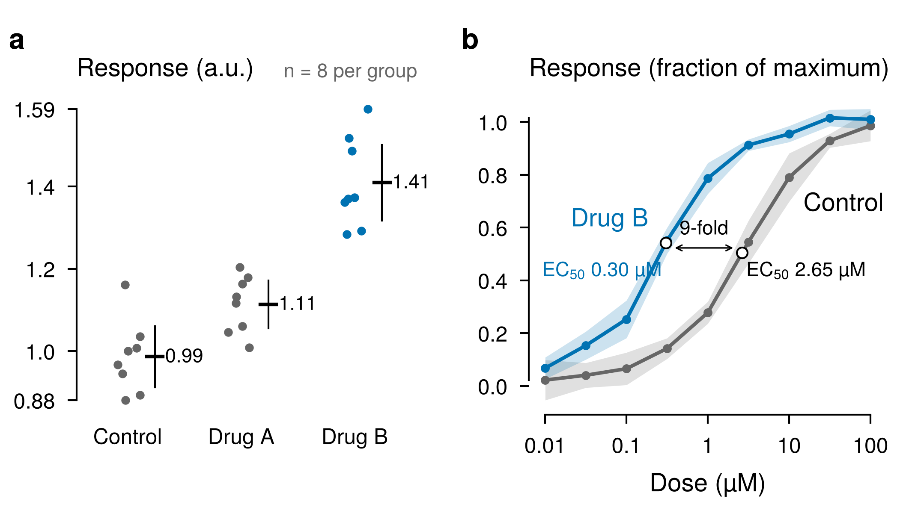
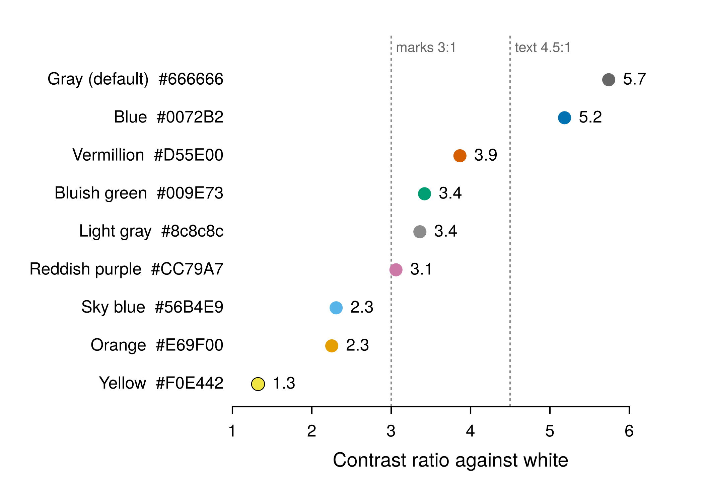

# Tufte

**An agent skill that applies Edward Tufte's vision to figures in scientific articles: show the data, make the comparison and the cause visible, carry as much information as the reader can use, and explain it on the page — then meet the journal's standards. Every rule names its source: Tufte's books, the statistics literature, or a journal's author guidelines.**


*The same data twice. **a**, matplotlib's defaults: bars of the means with SEM error bars suggest Drug A and Drug B work equally well. **b**, drawn by this skill: every culture shown, the means written in, and the finding labeled where it is — half the Drug A cultures responded strongly and half not at all, and its mean falls between the two groups, where no culture lies. Synthetic data.*

```bash
npx skills add mayar-ariss/tufte
```

Works with any coding agent the [skills CLI](https://skills.sh) supports. Covers matplotlib, seaborn, ggplot2 and plotnine, plus maps and schematic diagrams.

## What it does

Ask your agent for a figure as you normally would. The skill applies itself:

- *"Make a single-column Nature figure of the dose–response data in assay.csv, with 95% confidence intervals."*
- *"Redraw this bar chart of group means so reviewers can see the individual measurements."*
- *"Turn these four ggplot panels into one figure with shared axes and panel letters for Science."*
- *"Review this figure script before submission."*
- *"Draw the signalling pathway as a schematic for the paper."*

The skill has three parts, in order of authority.

**1. Tufte's principles design the figure** (rules 1–14):

- **Show the data**, not only summaries of it, and keep graphical integrity (the lie factor, bars from zero, the same design across panels).
- **Show the comparison and the cause**: "Compared to what?" answered on the page; the explanatory variable on an axis; every case included, zeros and non-responders too (the lesson of the Challenger O-ring data).
- **Carry information**: small multiples for multivariate data; high data density; multifunctioning elements such as range frames that report the data's range.
- **Explain on the graphic, generously**: names, values, events and findings written beside what they explain; direct labels instead of legends.
- **Stay clear by design, not by omission**: erase what carries no information; layer the rest from dark data to light references, so the figure reads at a glance and up close.
- **Gray first, strong color in small areas**; type that is clear, precise and modest, running horizontally.

**2. The statistics literature adds the evidence Tufte left open** (rules 15–19): every observation for small samples instead of dynamite plots, error bars defined as SD, SEM or 95% confidence intervals, *n* stated, effect sizes before p-values, log axes for multiplicative data.

**3. The journal's standards govern production** (rules 20–25): widths in millimeters (89 or 183 mm for Nature), Helvetica at 5–7 pt, the title and documentation in the caption, line weights from 0.25 to 1 pt, panel letters in the journal's style, vector PDF with embedded fonts.

Nothing is invented: no target line, comparison or explanatory variable that is not in the data.

If your project already has a figure style or the journal names its own requirements, the skill keeps them and applies Tufte's principles and the evidence rules to the content.

## Faithfulness to Tufte

Tufte wrote about printed evidence, and many of his central examples are scientific: Snow's cholera map, Minard's map of the Russian campaign, the Challenger O-ring data. His vision suits a journal page, and the skill keeps it whole. Tufte is often read as a minimalist; he is not. He asks for the data, the comparison and the cause, as much detail as the reader can use, and words on the graphic — and he erases only what carries no information. "To clarify, add detail" (*Envisioning Information*, ch. 2).

Where the skill departs from him, it says so in the rule and lists the departure here:

| Departure | Why |
|---|---|
| **Helvetica instead of serif type** | Tufte sets data graphics in serif type (*The Visual Display of Quantitative Information*, p. 183). Science prefers Helvetica and Nature asks for Helvetica or Arial. Only the typeface changes: everything else he asks of type holds, and his own books set tables in a sans serif. |
| **The title in the caption** | Tufte puts a detailed title on the graphic; journals put it in the caption. Labels, values and explanations stay on the graphic. |
| **Bold panel letters; sentence case** | Journal style. Sentence case is a narrower form of Tufte's upper-and-lower case. |
| **Error bars, p-values, log scales** | Tufte gives no rule; the skill takes them from the literature: Cumming et al. (2007), Vaux (2012) and Krzywinski and Altman (2013) on error bars, Weissgerber et al. (2015) on showing the data, Wasserstein and Lazar (2016) on p-values, Cleveland (1994) on log scales, Wong (2011) and Crameri et al. (2020) on color. These extend Tufte; none contradicts him. |

Each rule is labeled **Tufte** (book and chapter), **Literature** (author and year), **Journal** (quoted, with the date read), **convention** or **extension**.

## Examples

All figures are drawn at a journal width by `_docs/generate_showcase.py`, which runs the same code the skill gives an agent. Data are synthetic except for the cholera map.



*Nature single column, 89 mm. **a**, every culture shown (*n* = 8 per group), with means, 95% confidence intervals and the means' values; the range frame's ends report the data's range. **b**, dose on the x-axis as the explanatory variable, on a log scale labeled with values; the finding is drawn where it is — each half-maximal dose marked on its curve, and the 9-fold shift between them. Panel letters in Nature's 8 pt bold lowercase; no title in the artwork. From `examples/matplotlib-publication.py`, which checks its caption against the data.*


*Small multiples with two readings, 183 mm. Mice on the high-fat diet gained the most mass by week 12 (31.7 g); those on the restricted diet lost mass. At a glance, the four means; up close, every mouse as a thin light line under its diet's mean (*n* = 8 per diet). One scale in every panel; the week-0 mean as the shared reference; the ending values written in.*


*Tufte's designs for distributions, 120 mm. **a**, paired measurements as a slopegraph, one line per subject: pressure fell in 10 of 12 subjects; the two who rose are in blue, and both counts are written on the graphic. **b**, Tufte's quartile plot (no box: a dot at the median, a gap for the middle half, lines to the extremes), with each median's value, *n* = 40 per site.*


*John Snow's 1854 cholera data, drawn by `rules/maps.md`, 120 mm. 359 of the 578 deaths lay nearer the Broad Street pump (blue) than any other; the next pump, South Soho, has 64. One dot per death; straight-line distances; the population at risk is not shown (Tufte, Visual Explanations, p. 35). Data: Snow (1855), digitized by Dodson and Tobler, via the R package HistData.*



*The palette's contrast against a white page. Blue, vermillion, bluish green and reddish purple clear 3:1 for marks; only blue and the default gray clear 4.5:1 for text. `scripts/check_contrast.py` keeps the documented palette from drifting.*

## Supported libraries

| Library | Rule file | Language |
|---|---|---|
| [matplotlib](https://matplotlib.org/) and [seaborn](https://seaborn.pydata.org/) | `rules/matplotlib.md` | Python |
| [ggplot2](https://ggplot2.tidyverse.org/) | `rules/ggplot2-plotnine.md` | R |
| [plotnine](https://plotnine.org/) | `rules/ggplot2-plotnine.md` | Python |

## How it's organized

| Path | What it holds |
|---|---|
| `SKILL.md` | The workflow and 25 rules in three parts — Tufte's principles, scientific evidence, journal production — with chart types, quick references, anti-patterns, a checklist and the list of departures from Tufte. The agent always reads this. |
| `rules/matplotlib.md` | Setup, layers, helpers (range frames with labeled ends, direct labels, annotations, panel letters, confidence intervals, quartile and paired plots, log axes), complete examples, export |
| `rules/ggplot2-plotnine.md` | A journal theme, the same figures in ggplot2 and plotnine, patchwork panels, export with embedded fonts |
| `rules/typography-and-color.md` | Helvetica and sizes per journal, Okabe–Ito colors, color maps, contrast on white |
| `rules/small-multiples-and-panels.md` | Multi-panel layout, small multiples, slopegraphs, quartile and dot-dash plots, sparklines in tables |
| `rules/anti-patterns.md` | Common faults in scientific figures, with per-library detection and fixes |
| `rules/journals.md` | Nature, Science and PLOS requirements, quoted and dated |
| `rules/references.md` | Full references for Tufte, the literature and the journal guides |
| `rules/maps.md` | Maps, drawn only from Tufte's writing on data maps |
| `rules/diagrams-flowcharts.md` | Schematics and mechanism diagrams, drawn only from Tufte's writing on connectors, layering and explanation |
| `examples/matplotlib-publication.py` | A complete two-panel journal figure that checks its own caption |
| `scripts/check_contrast.py` | Checks the documented palette against the contrast minimums |
| `scripts/check_code.py` | Runs every Python code block in `rules/matplotlib.md` and the example |
| `_docs/` | The README figures and the script that draws them |

## Contributing

Issues and pull requests are welcome. Before opening a PR:

- **Changed a color?** Update `rules/typography-and-color.md`, then run `python3 scripts/check_contrast.py`.
- **Changed Python code in `rules/matplotlib.md` or `examples/`?** Run `python3 scripts/check_code.py`; it exits non-zero if any block fails.
- **Changed the README figures?** Run `python3 _docs/generate_showcase.py`. It checks each caption's claims against the data; update the README caption if the data change.
- **Changed a journal requirement?** Quote the journal's current guide in `rules/journals.md` and update the date.

The figures in `_docs/` were rendered with TeX Gyre Heros, a free metric clone of Helvetica; on a machine with Helvetica installed, the scripts use Helvetica.

## Credits

This skill began as a fork of [caylent/tufte-data-viz](https://github.com/caylent/tufte-data-viz) by Caylent, a general Tufte skill for charts and dashboards, and all credit for the original goes to its authors. It has since been rewritten for scientific articles: journal requirements, the statistics of uncertainty, print typography and color, rules for data maps and analytical diagrams, and a source label on every rule.

## Based on

- Edward Tufte, *The Visual Display of Quantitative Information* (1983; 2nd ed. 2001), *Envisioning Information* (1990), *Visual Explanations* (1997), *Beautiful Evidence* (2006)
- The author guidelines of Nature, Science and PLOS
- The statistics and visualization literature listed in [`rules/references.md`](rules/references.md)

## License

MIT; see [LICENSE](LICENSE). Original work © 2026 Caylent; additions and changes in this repository © 2026 Mayar Ariss, under the same license.
